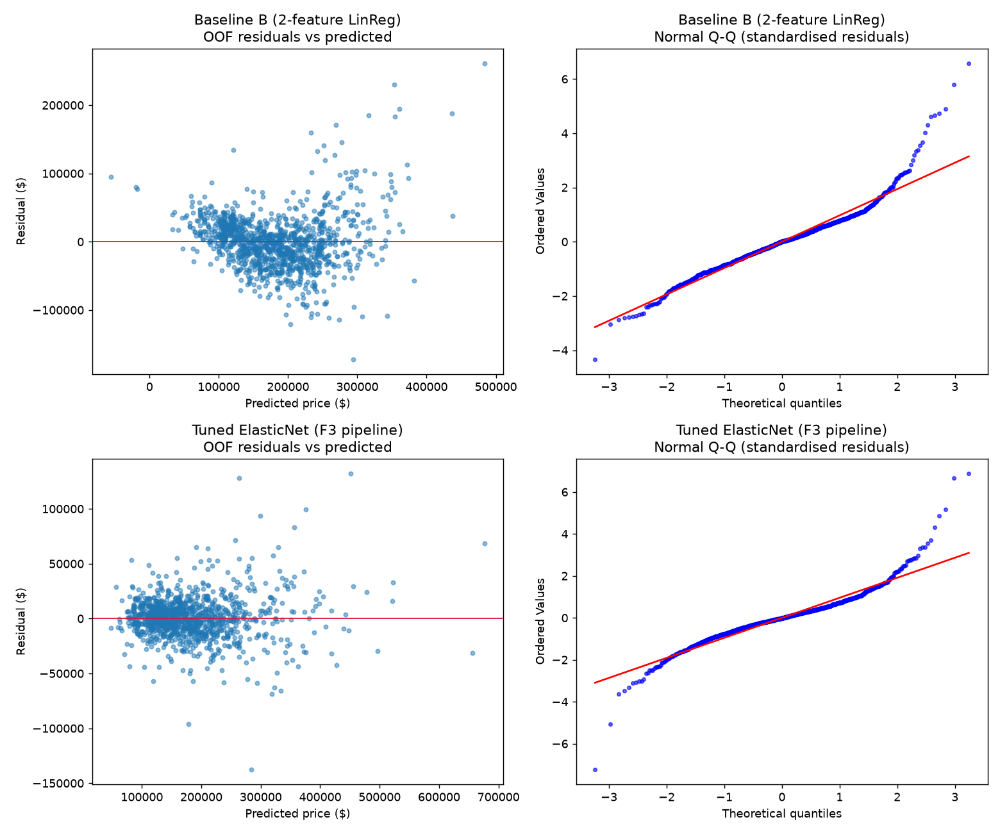

# Ames Housing Price Regression

Predict the sale price of residential homes in Ames, Iowa from 79 property features, built up in five
stages from a dummy baseline to a tuned, regularised linear model. Every stage is a runnable script that
reports **5-fold CV error in dollars** so each modelling decision can be judged against the last one.

**Final model:** `ElasticNet(alpha=7.2e-4, l1_ratio=0.5)` on engineered features, log1p target
- **5-fold CV:** RMSE **$19,064** / MAE **$12,927**
- **Untouched holdout (292 homes):** RMSE **$21,022** / MAE **$13,562** (MAPE ~7.7% in CV)
- That is a 76% RMSE reduction vs. the median-price dummy ($88,667 on holdout).

## Data and leakage rules

- **Dataset:** OpenML `house_prices` (Ames Housing, 1,460 rows, 79 features + `Id`; target `SalePrice`).
- **Split first:** 80/20 `train_test_split(random_state=42)` is the very first operation, giving 1,168 train / 292 test rows.
  `X_test` is not looked at until the final evaluation in Stage 5, which runs **once**; no model, feature
  or hyperparameter was changed after seeing it.
- **Outliers:** the 2 known corrupted rows (`GrLivArea > 4000` and `SalePrice < 300000`) are dropped from
  **train only** (1,168 -> 1,166). All 292 test rows are kept.
- **`Id`** is dropped (a row label, not a feature).
- **Everything fitted lives inside the Pipeline:** imputers, encoders, scalers and the feature engineer are
  re-fitted on each CV fold's training portion only. Column groups come from the schema, not data statistics.
- **Validation:** 5-fold shuffled `KFold(random_state=42)` everywhere, so all models see identical folds.
- **Metrics:** RMSE and MAE in dollars. For log-target models the prediction is `expm1`'d back before scoring.

## Progression

| Stage | Model | CV RMSE | CV MAE | Test RMSE | Test MAE |
|---|---|---|---|---|---|
| 1 | A: Dummy (median) | $79,047 +/- 1,567 | $54,667 | $88,667 | $59,568 |
| 1 | B: LinReg [OverallQual, GrLivArea] | $39,699 +/- 499 | $28,435 | $43,531 | $28,999 |
| 1-2 | C: B + log1p target | $35,300 +/- 1,829 | $25,316 | $36,385 | $24,646 |
| 2 | D: full ColumnTransformer + LinReg, log1p | $24,055 +/- 2,362 | $15,465 | $22,595 | $15,161 |
| 2 | E: D with Ridge(alpha=10) | $19,734 +/- 1,502 | $13,415 | $21,774 | $14,534 |
| 3 | F1: E + engineered features | $19,665 +/- 1,354 | $13,395 | n/a | n/a |
| 3 | F2: F1 + log1p on 11 skewed columns (failed) | $20,901 +/- 1,853 | $13,562 | n/a | n/a |
| 3-4 | F3: F1 + log1p on 4 size columns | $19,285 +/- 1,290 | $12,955 | $21,309 | $13,826 |
| 4 | Tuned Lasso (alpha=4.64e-4) | **$19,059 +/- 1,330** | $12,946 | **$20,992** | **$13,519** |
| 4 | Tuned ElasticNet (alpha=7.20e-4, l1=0.5) | $19,064 +/- 1,343 | **$12,927** | $21,022 | $13,562 |

CV figures are on the cleaned 1,166-row train set (so A-C differ slightly from raw Stage 1 numbers).
F1/F2 were CV-only experiments and were not scored on the holdout.

| Script | Purpose |
|---|---|
| `stage1_baseline.py` | Split, train-only EDA, baselines A/B/C |
| `stage2_preprocessing.py` | Outlier removal, leakage-free ColumnTransformer, models D/E |
| `stage3_feature_engineering.py` | `FeatureEngineer` transformer (TotalSF, TotalBath, HouseAge, ...), F1/F2 |
| `stage4_tuning.py` | F3, then `GridSearchCV` for Ridge / Lasso / ElasticNet |
| `stage5_error_analysis.py` | OOF error analysis, diagnostics figure, final holdout evaluation |

## Key findings

- **The target is skewed; the log is not.** Train `SalePrice` has skew 1.74 / excess kurtosis 5.48; after
  `log1p` it is 0.12 / 0.70. Fitting in log space and inverting turns the multiplicative price structure into an
  additive one, and guarantees positive predictions (Baseline B predicts negative prices for some homes).
- **Two rows distorted everything.** Removing the 2 high-leverage outliers cut Baseline B's fold-to-fold RMSE std
  from $3,394 to $499. On the uncleaned data the log target actually *hurt* (C $45,055 vs B $42,182 RMSE);
  after cleaning it helps ($35,300 vs $39,699).
- **Full features need regularisation.** Going from 2 to 283 post-encoding features cut RMSE from $35k to $24k
  (D), and adding an L2 penalty cut it again to $19.7k (E): 283 mostly-dummy columns on 1,166 rows overfit.
- **Feature engineering must respect zeros.** Taking log1p of 11 columns (F2) made things worse (+$1.2k RMSE):
  my hypothesis (untested) is that zero-heavy columns (`MasVnrArea`, `2ndFlrSF`, `TotalPorchSF`) become spiky after
  standardising. Restricting it to
  the 4 strictly positive size columns (F3) beat F1 by ~$380.
- **Tuning is worth little here.** Best-of-grid gains over untuned F3 are ~$225 RMSE (1.2%), smaller than the
  fold std (~$1.3k). Treat Ridge / Lasso / ElasticNet as equivalent; the tuned CV scores are also slightly
  optimistic since they are best-of-grid on the selection folds.
- **Lasso gives a free sparse model.** It zeroes 166 of 283 features (59%) at no accuracy cost; ElasticNet zeroes
  153. Strongest signals: `Qual_x_TotalSF`, log `TotalSF`, a handful of premium neighbourhoods (StoneBr,
  Crawfor) and `MSZoning_C (all)` (commercial zoning, negative).
- **CV is a mildly optimistic guide.** Holdout RMSE is ~$2k (10%) above CV for the final models, ~1.5 fold-stds, and the
  model ranking by RMSE is identical on CV and holdout. The 292-row holdout is itself a noisy estimate.

## Error analysis (Tuned ElasticNet, out-of-fold)



| Price quartile | n | Mean price | RMSE | MAE | MAPE |
|---|---|---|---|---|---|
| Q1 Cheap | 293 | $107k | $14.8k | $10.2k | 10.7% |
| Q2 Lower-Mid | 294 | $147k | $15.7k | $10.2k | 7.0% |
| Q3 Upper-Mid | 287 | $186k | $15.2k | $11.8k | 6.3% |
| Q4 Luxury | 292 | $286k | $27.6k | $19.5k | 6.6% |

- **Errors scale with price, in percent they are roughly flat (~6-7%).** That is what a log-target model should
  do; dollar RMSE nearly doubles in the luxury quartile. The cheap quartile's higher MAPE is partly an artefact
  of slicing on the actual price (low-priced homes are mechanically over-predicted), not just model weakness.
- **Non-standard sales are the weak spot.** `Abnorml` (n=77) and `Family` (n=18) sales have ~15.5-16% MAPE
  vs. 6.7% for `Normal` (n=964): foreclosures and family transfers are priced for reasons the physical features
  cannot see. `Partial` (new builds, n=96) has the largest dollar errors (RMSE $34.8k): 5 of the 10 worst
  predictions are `Partial`, in both directions.
- **A handful of rows dominate the error.** The 10 worst predictions (0.9% of train) account for 24% of total
  squared error. Residuals are heavy-tailed (excess kurtosis 8.2; see the Q-Q plot), so RMSE is far more sensitive to
  them than MAE.
- **Versus Baseline B:** the final model removes the negative predictions and most of the fan-shaped residual
  spread (residual std $39.7k -> $19.1k), though residual spread still grows mildly with price
  (Spearman(predicted, |residual|) = 0.24).

## Limitations and next steps

- Linear models only; gradient boosting or stacking would likely capture the interactions behind the largest misses.
- `SaleCondition` is partly a *post-hoc* label (it is only known once a sale has happened), so for a true
  pre-listing valuation, errors on `Partial` / `Abnorml` sales are an irreducible cost rather than a modelling gap.
- Use nested CV (or the holdout) for an unbiased estimate of tuned-model performance.

## Reproduce

```bash
python -m venv .venv && source .venv/bin/activate
pip install -r requirements.txt
python stage5_error_analysis.py   # stages 1-4 are importable and runnable on their own
```

The dataset is downloaded from OpenML on first run and cached under `data/` (git-ignored).
